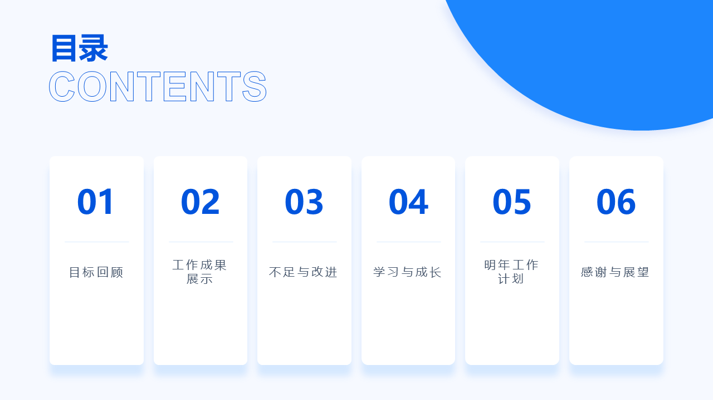
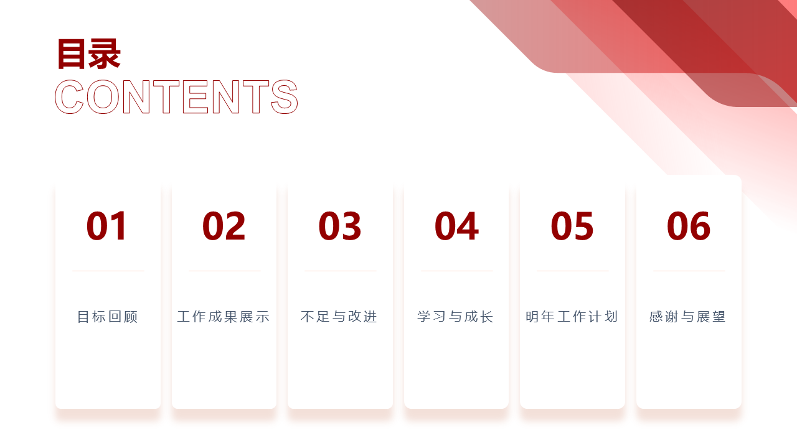
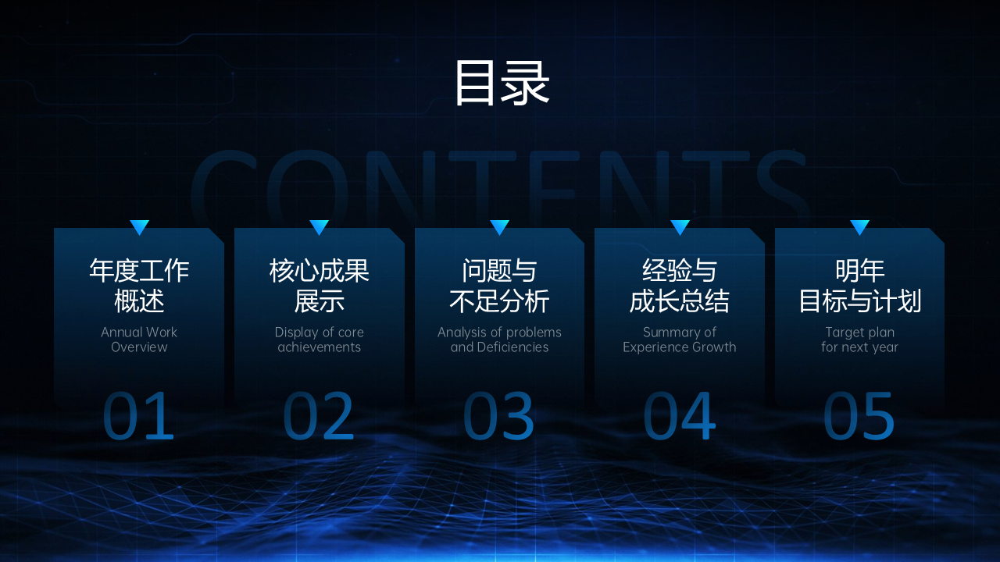

# Epoint Presentation

把材料整理成符合新点品牌风格、可继续编辑的企业演示文稿。先选 **蓝色系、红色系或科技风格**，再由 Agent 梳理内容与信息关系，优先试用知识库组件；正文不适配时使用技能内的排版规则，仍保持同一套色彩、字体和 Logo。

**当前技能版本：1.0.27。** [查看技能入口](SKILL.md) · [查看完整模板知识库](https://github.com/camillechi2018/Epoint-Presentaion-KnowledgeBase)

## 先看三种风格

| 蓝色系 · 蓝白简约 | 红色系 · 红白简约 | 科技风格 · 深蓝科技 |
| --- | --- | --- |
|  |  |  |

预览用于选择整稿视觉方向，不表示最终一定使用图中的页面。实际封面、目录、章节页和封底从适配的知识库模板或已校验的本地最小包中选择。

## 快速开始

将本仓库完整克隆到所用 Agent 的技能目录，确保 `SKILL.md`、`assets/`、`references/` 和 `scripts/` 都在同一目录。以 Codex 的用户技能目录为例：

```powershell
git clone https://github.com/camillechi2018/Epoint-Presentaion.git "$HOME/.codex/skills/epoint-presentation-next"
```

然后在支持技能的 Agent 中附上材料，例如：

> 调用 epoint-presentation-next，用这份报告制作一套可编辑 PPTX。先给我蓝色系、红色系、科技风格的预览供选择；保留材料中的事实和数字。

如果已指定风格，可直接说“用蓝色系制作”，不需要再次选择。完整模板知识库由 [`knowledge-base.json`](knowledge-base.json) 指向独立 Git 仓库；首次使用远端模板需要能够访问 GitHub。字体使用 Microsoft YaHei 和 Arial，实际文字换行仍需在生成环境中检查。

## 它怎样组织一份 PPT

1. **理解材料。** 先提炼结论、证据、信息关系和页次，不把模板示例文字当成业务事实。
2. **锁定风格。** 整稿使用所选色系、字体、Logo 和页面规则；红色系使用单色 Logo。
3. **优先匹配知识库。** 按页面职责、信息关系、字段和容量试填组件。封面、目录、章节页、封底必须使用合格的模板；同一整稿的章节页保持同一版式。
4. **补足正文。** 没有合适组件时，先使用技能内的正文排版规则；仍不适用时，在所选风格约束下自由编排，并记录页面来源。
5. **检查成稿。** 核对文字边界、字体、颜色、Logo、图片及实际 PowerPoint 渲染；保留需要人工审阅的状态。

详细规则见[选版与知识库契约](references/library-contract.md)、[正文托底排版](references/body-fallback-layouts.md)和[质量检查](references/source-and-qa.md)。

## 能力与边界

| 场景 | 当前处理方式 |
| --- | --- |
| 可编辑 PPTX | 保留可编辑文字和适用的原生图形；知识库组件按当前验收状态开放。 |
| 三种风格 | 技能自带颜色、字体、Logo 规则和预览；科技风格独立于简约蓝红版。 |
| 目录变项数 | 依据具体目录组件的已验证项数和文字容量选版。 |
| 知识库暂不可达 | 可检查已校验的本地结构页最小包；无合格结构页时停止完整出稿。仅制作正文局部草稿可使用离线品牌排版。 |
| HTML 与动效 | 按具体组件的独立验收状态判断，不能从静态 PPTX 可用推断其已可用。 |

技能默认添加 Logo，并锁定主题变量；具体页面仍须用本次材料试填。模板和品牌素材目前标记为 `draft_pending_review`，这是审阅状态，不是正式品牌授权或交付质量保证。

## 仓库结构

```text
Epoint-Presentaion/
├── SKILL.md                 Agent 的调用规则
├── knowledge-base.json      完整知识库的 Git 地址与本地回退配置
├── assets/
│   ├── brand/               Logo、颜色与字体变量
│   ├── style-kits/          蓝、红、科技三套风格资料
│   ├── style-previews/      三张风格预览
│   ├── layouts/             正文托底排版规则
│   └── minimal-template-pack/  离线结构页最小包
├── references/              按任务读取的细则
├── scripts/                 选版、填充、组装及审计工具
└── tests/                   局部回归测试
```

完整模板、组件目录和专项验收记录位于[独立知识库仓库](https://github.com/camillechi2018/Epoint-Presentaion-KnowledgeBase)，不随本技能仓库重复分发。历史本地备份 `assets/minimal-template-pack.previous/` 不进入 Git 仓库。

## 授权状态

本仓库目前没有 `LICENSE` 文件，也没有明确授予代码、Logo、原稿模板和图片的再分发或商用许可。仓库公开可读不代表上述素材已获开放授权。需要对外复用时，应先分别确认代码与品牌素材的权利范围。
